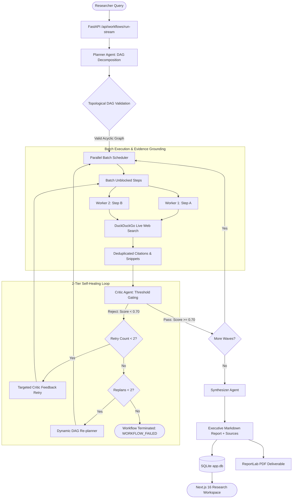

# AegisFlow: Enterprise Multi-Agent Orchestration Platform

> **A Production-Grade Planner–Executor–Critic Multi-Agent Platform**  
> Powered by Google Gemini, Live Web Grounding (DuckDuckGo), Passwordless Email OTP Authentication, and an Enterprise Governance Architecture.

[](https://fastapi.tiangolo.com)
[](https://nextjs.org)
[](https://python.org)
[](https://ai.google.dev)
[](frontend/scripts/)
[](tests/)

---

## 📖 System Overview

**AegisFlow** is an autonomous, observable, and resilient multi-agent research platform designed to synthesize high-depth research deliverables from natural language user objectives. It eliminates monolithic prompting vulnerabilities (hallucination cascades, silent omission, context saturation) through a formal Finite State Machine (FSM) coordinating 5 specialized agent roles:

1. **Planner Agent:** Decomposes complex research questions into structured Directed Acyclic Graphs (DAGs) with 3–7 discrete steps and topological dependency ordering.
2. **Executor Agent:** Concurrently executes plan steps with scoped ancestor context, querying real-time web search tools and extracting ground-truth source evidence.
3. **Critic Agent:** Conducts adversarial audits across numerical correctness, completeness, and relevance thresholds ($\ge 0.70$), detecting factual hallucinations and triggering bounded self-correction.
4. **Dynamic Re-Planner:** Mutates remaining steps upon repeated execution failure (max 2 retries, max 2 replans) while preserving verified passed steps.
5. **Synthesizer Agent:** Aggregates approved step deliverables, master comparison tables, and deduplicated citations into an executive report.
6. **Role Governance:** Strict role segregation between **Researchers** (operational research execution, report viewing, follow-up threads) and **Administrators** (user registry, token expenditure telemetry, security audit trail).
7. **Passwordless OTP Authentication:** Eliminates password vulnerabilities via 6-digit cryptographic email verification codes and disposable email platform rejection.

For full architectural blueprints, diagrams, and entry point mappings, see **[`ARCHITECTURE.md`](ARCHITECTURE.md)** and the **[`Enterprise_MultiAgent_Orchestrator_PRD_v2.0.md`](Enterprise_MultiAgent_Orchestrator_PRD_v2.0.md)**.

---

## 🎯 Architecture Diagram



---

## 🧭 System Entry Points

| Layer | Entry File | Protocol / Port | Purpose |
| :--- | :--- | :--- | :--- |
| **Backend API** | [`src/api/main.py`](src/api/main.py) | HTTP / Port `8000` | FastAPI server bootstrap, CORS, router registration, OpenAPI/Swagger docs (`http://localhost:8000/docs`). |
| **Frontend Web** | [`frontend/src/app/page.tsx`](frontend/src/app/page.tsx) | HTTP / Port `3000` | Next.js 16 App Router interface: Seamless Home landing, search composer, and live research workspace canvas. |
| **Agent Triad Orchestrator** | [`src/orchestrator/engine.py`](src/orchestrator/engine.py) | Python Engine | Orchestrates Planner-Executor-Critic-Synthesizer state machine and self-correction. |
| **Research History** | [`frontend/src/app/history/page.tsx`](frontend/src/app/history/page.tsx) | Browser View | Interactive research thread archive with instant reload, thread deletion, and search filtering. |
| **Admin Governance Console** | [`frontend/src/app/admin/page.tsx`](frontend/src/app/admin/page.tsx) | Browser View | Administrative dashboard for user management, system-wide workflows, and server audit logs. |
| **PDF Export Engine** | [`src/api/routes/workflows.py`](src/api/routes/workflows.py) | HTTP Endpoint | `/api/export-pdf`: ReportLab-powered publication-grade PDF generator with citations and metadata. |
| **Benchmarking Suite** | [`benchmarks/run_benchmarks.py`](benchmarks/run_benchmarks.py) | CLI Test Harness | Standardized 20-task benchmark suite measuring WSR, Recovery Rate, and Critic precision. |

---

## 📁 Directory Structure

```text
OJTProject/
├── ARCHITECTURE.md                  # Comprehensive architectural reference & design decisions
├── Enterprise_MultiAgent_Orchestrator_PRD_v2.0.md # Product Requirements Document (PRD v2.0)
├── OJT_Project_Logbook_AegisFlow.md # Complete milestone logbook and evaluation report
├── README.md                        # Quick start guide and project overview
├── app.db                           # SQLite persistent database (Users, Workflows, OTP Codes)
├── requirements.txt                 # Python dependencies (FastAPI, SQLModel, ReportLab, etc.)
├── pytest.ini                       # Pytest execution configuration
│
├── benchmarks/                      # Empirical Performance Benchmarking
│   ├── run_benchmarks.py            # Automated runner for 20 standardized tasks
│   ├── tasks.json                   # Standardized 20-task dataset across 10 categories
│   └── results.md                   # Latency, token expenditure, and recovery metrics
│
├── logs/                            # Production server logs directory
│   ├── user_activity.log            # Human-readable timestamped server security audit trail
│   └── user_workflows.jsonl         # Machine-readable structured JSONL telemetry logs
│
├── src/                             # Core Backend Source Code
│   ├── agents/                      # Specialized Agent Implementations
│   │   ├── planner.py               # Natural language goal to validated DAG
│   │   ├── executor.py              # Scoped context execution & web search grounding
│   │   ├── critic.py                # Adversarial evaluation & threshold gating
│   │   └── synthesizer.py           # Final executive report synthesis & citations
│   │
│   ├── orchestrator/                # Multi-Agent State Machine
│   │   └── engine.py                # Topological batch scheduler & recovery loops
│   │
│   ├── tools/                       # Agent Execution Tools
│   │   └── search.py                # Live Web Search tool via DuckDuckGo
│   │
│   ├── llm/                         # LLM Gateway & Provider Abstraction
│   │   └── gateway.py               # Google Gemini client with token counting & failover
│   │
│   ├── models/                      # Pydantic Schemas & Data Contracts
│   │   └── schemas.py               # WorkflowState, Plan, Step, CriticReview models
│   │
│   └── api/                         # FastAPI REST & SSE Streaming API
│       ├── main.py                  # API Entry point: Application bootstrap, CORS, routers
│       ├── auth.py                  # Passwordless OTP auth, email validation, JWT issuance
│       ├── database.py              # SQLite data access layer
│       ├── audit_logger.py          # Security audit logger
│       └── routes/                  # API Route Handlers
│           ├── workflows.py         # POST /run-stream (SSE), /api/export-pdf
│           └── admin.py             # GET /stats, GET /users, GET /workflows, GET /server-logs
│
├── frontend/                        # Next.js 16 + Tailwind CSS Frontend
│   ├── public/                      # Static assets and favicons
│   ├── scripts/                     # Automated UI Invariant & Token Test Harness
│   │   ├── home-locked-tokens.json  # Locked CSS token baseline snapshot
│   │   ├── check-locked-tokens.mjs  # Token baseline comparator
│   │   ├── test-home-refinement.mjs # 64px rail, 820px layout, contrast tests (7/7 PASS)
│   │   ├── test-pipeline-stage.mjs  # PRD Invariants & Multi-Scenario suite (33/33 PASS)
│   │   ├── test-research-view-model.mjs # View-model & fixture suite (24/24 PASS)
│   │   └── test-typography.mjs      # Typography pairing and optical token tests (33/33 PASS)
│   │
│   ├── src/
│   │   ├── app/                     # Next.js App Router Pages
│   │   │   ├── page.tsx             # Unified Home & Live Research Canvas
│   │   │   ├── layout.tsx           # Global root layout with theme & auth providers
│   │   │   ├── globals.css          # Semantic tokens, typography resets, smooth sidebar transitions
│   │   │   ├── history/page.tsx     # Thread archive with instant reload and delete
│   │   │   ├── admin/page.tsx       # Admin console: User table, workflow telemetry, server audit logs
│   │   │   ├── login/page.tsx       # Passwordless OTP email login
│   │   │   └── signup/page.tsx      # Passwordless OTP email registration
│   │   │
│   │   ├── components/              # UI Components
│   │   │   ├── navbar.tsx           # Responsive header with user profile menu
│   │   │   ├── research-sidebar.tsx # Collapsible 64px icon rail with zero-jerk transitions
│   │   │   ├── research-workspace.tsx # Core research layout: Question, Progress, Report, Sources
│   │   │   ├── theme-toggle.tsx     # Dark/Light mode switcher
│   │   │   └── research/            # Modular Research Components
│   │   │       ├── QuestionCard.tsx        # Editable query card with inline stop controls
│   │   │       ├── ResearchProgressRow.tsx # Compact live status indicator
│   │   │       ├── StepsChecklist.tsx      # Expandable DAG step progress checklist
│   │   │       ├── AnswerBody.tsx          # Rendered report markdown with interactive citation tooltips
│   │   │       ├── SourcesPanel.tsx        # Sticky right-hand cited sources panel with favicons
│   │   │       ├── ConversationThread.tsx  # Interactive multi-turn follow-up question thread
│   │   │       └── ReportActionsPanel.tsx  # One-click Copy, Share, Save, and Export as PDF
│   │   │
│   │   └── lib/                     # Frontend Utilities & Contexts
│   │       ├── api.ts               # Typed API client, SSE stream consumer, download helpers
│   │       ├── auth-context.tsx     # React AuthContext: Token storage, user state, OTP actions
│   │       ├── research-view-model.ts # Reactive mapping from workflow state to UI view-model
│   │       └── typography-config.ts # Typography pairings and font stack definitions
│   │
│   ├── package.json                 # Frontend dependencies (Next.js 16, Lucide, Tailwind)
│   └── tsconfig.json                # TypeScript compiler configuration
│
└── tests/                           # Complete Pytest Test Suite
    ├── test_api.py                  # API endpoints, OTP auth flow, RBAC, ownership checks
    ├── test_planner.py              # Planner DAG decomposition & dependency ordering
    ├── test_executor.py             # Step execution, dependency context scoping
    ├── test_critic.py               # Critic thresholds, PASS/RETRY triggers, score boundaries
    ├── test_synthesizer.py          # Report synthesis & source citation formatting
    ├── test_parallel.py             # Topological batching & parallel execution speedup
    ├── test_recovery.py             # Bounded retry recovery & replanning loop limits
    ├── test_schemas.py              # Pydantic validation (acyclic DAG, step IDs, ratings)
    ├── test_pdf_export.py           # ReportLab PDF deliverable generation tests
    └── test_domain_classifier.py    # URL domain taxonomy and source verification
```

---

## ⚡ Quickstart Guide

### 1. Prerequisites
- **Python 3.11+** installed
- **Node.js 18+** & **npm** installed
- Google Gemini API Key (`GEMINI_API_KEY`)

### 2. Backend Setup
```bash
# 1. Clone repository & navigate to root
cd OJTProject

# 2. Activate virtual environment
.\.venv\Scripts\Activate.ps1

# 3. Configure environment variables (.env)
# Create .env from .env.example and set:
# GEMINI_API_KEY="your-gemini-api-key"
# JWT_SECRET="your-jwt-secret-key"

# 4. Start FastAPI server
uvicorn src.api.main:app --host 0.0.0.0 --port 8000 --reload
# API Docs available at http://localhost:8000/docs
```

### 3. Frontend Setup
You can run the frontend either from the root using `--prefix`, or by entering the `frontend` directory:

```bash
# Option A: From root directory
npm --prefix frontend run dev

# Option B: From inside the frontend directory
cd frontend
npm run dev
# Web application available at http://localhost:3000
```

---

## 🧪 Testing & Verification

AegisFlow features comprehensive automated test suites for both backend and frontend layers:

```bash
# Run all Frontend Invariant & UI Verification Suites
npm --prefix frontend run test:home       # 7/7 PASS (64px rail, 820px layout, contrast)
npm --prefix frontend run test:pipeline   # 33/33 PASS (PRD FSM & Invariants)
npm --prefix frontend run test:viewmodel  # 24/24 PASS (Reactive view-model & fixtures)
npm --prefix frontend run check:tokens    # PASS (CSS token baseline check)
npm --prefix frontend run test:typography # 33/33 PASS (Self-hosted font pairings)

# Run Backend Pytest Suite
pytest tests/ -v
# 25+ Unit and Integration Tests covering domain classification, schemas, and PDF export
```

---

## 🏛️ The 11 Immutable Tenets

1. **Reliability Before Autonomy:** A system that reliably executes a constrained 5-step plan is infinitely more valuable than an autonomous agent that hallucinates on step 6.
2. **Critic Before State Mutation:** No output is committed to shared state without explicit validation by the Critic agent.
3. **Explicit State Over Hidden Memory:** All intermediate thoughts, findings, and errors must live in structured, inspectable state rather than hidden LLM chat buffers.
4. **Failure Must Be Visible:** Failures must never be swallowed or silently bypassed. Every tool error or validation failure is an explicit, logged event.
5. **Bounded Retries Over Infinite Loops:** Every execution retry and re-planning attempt has hard numerical limits to prevent infinite execution traps.
6. **Evidence Before Synthesis:** The final synthesizer is prohibited from introducing external unverified assertions; all claims must be grounded in validated step findings.
7. **Parallelism Strictly By Dependency:** Concurrency is only unlocked when topological sort mathematically guarantees zero prerequisite dependencies.
8. **Cost-Conscious Execution:** Every plan step must balance reasoning depth against token economics and latency budgets.
9. **Auditability & Provenance:** Every sentence in a synthesized deliverable must be traceable back to an intermediate step and verified URL citation.
10. **Metric-Driven Evaluation:** Progress is measured strictly via standardized 20-task benchmarks, recovery rates, and empirical F1 scores.
11. **Graceful Degradation:** When all retries and re-planning attempts fail, the system delivers partial validated findings with explicit caveats rather than hallucinated completion.
