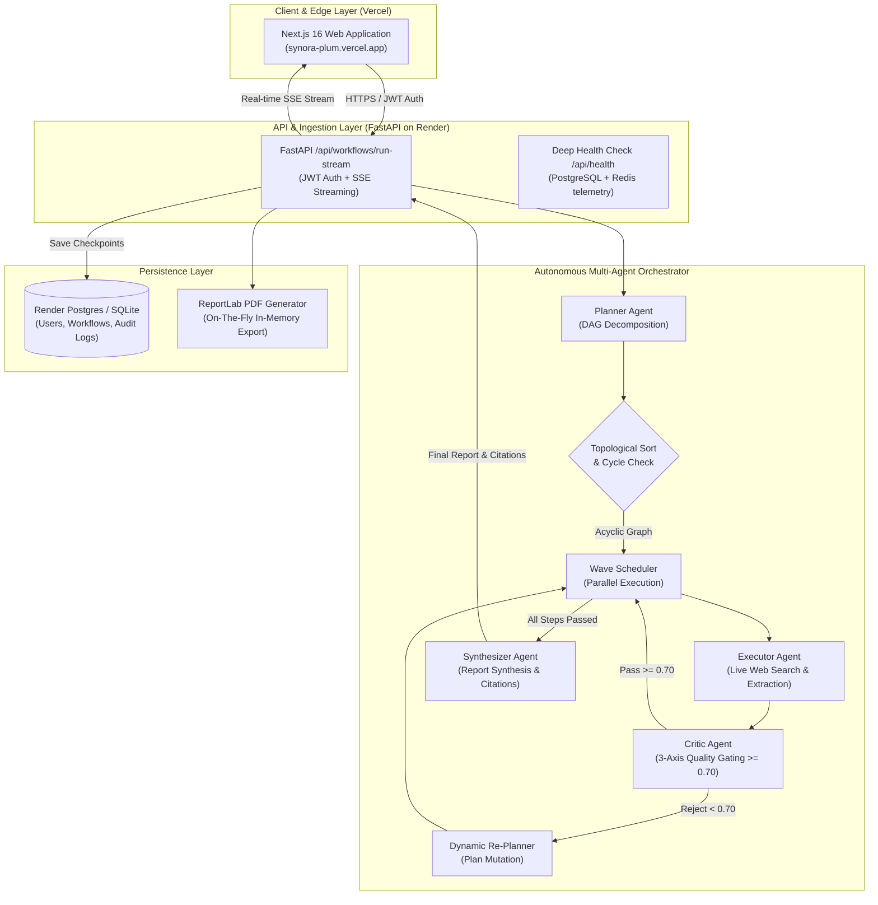

# Synora: Autonomous AI Research Platform

> **A Production-Grade Multi-Agent Research Platform Powered by Coordinated Intelligence**  
> Decomposes complex inquiries into validated Directed Acyclic Graphs (DAGs), gathers ground-truth evidence across live sources, enforces adversarial 3-axis quality gating, and synthesizes publication-grade deliverables with traceable citations.

[](https://synora-plum.vercel.app/)
[](https://synora-plum.vercel.app/)
[](https://fastapi.tiangolo.com)
[](https://ai.google.dev)
[](https://www.postgresql.org/)
[](tests/)
[](frontend/scripts/)

---

## 🌐 Live Production Deployment

- **Frontend Application (Vercel):** [https://synora-plum.vercel.app/](https://synora-plum.vercel.app/)
- **Backend Architecture:** FastAPI Web Service & Python Multi-Agent Engine on [Render](https://render.com)
- **Database Engine:** Managed PostgreSQL 16 (Production) with SQLite automatic fallback (Local Dev)
- **CI/CD Pipeline:** Automated GitHub Actions testing and validation workflow (`.github/workflows/ci-cd.yml`)

---

## 📖 System Overview

**Synora** is an autonomous, observable, and resilient research platform engineered to eliminate monolithic prompting failures (hallucination cascades, context window saturation, silent omission) through a formal Finite State Machine (FSM) coordinating 5 specialized agent roles:

1. **Planner Agent:** Decomposes complex research objectives into structured Directed Acyclic Graphs (DAGs) with 3–7 discrete steps and topological dependency ordering.
2. **Executor Agent:** Concurrently executes plan steps with scoped ancestor context, querying real-time web search tools and extracting ground-truth source evidence.
3. **Critic Agent:** Conducts adversarial audits across correctness, completeness, and relevance thresholds ($\ge 0.70$), detecting factual hallucinations and triggering bounded self-correction.
4. **Dynamic Re-Planner:** Mutates remaining steps upon repeated execution failure (max 2 retries, max 2 replans) while preserving verified passed steps.
5. **Synthesizer Agent:** Aggregates approved step deliverables, master comparison tables, and deduplicated citations into an executive report with on-the-fly PDF and Markdown export.
6. **Role Governance:** Strict role segregation between **Researchers** (operational research execution, report viewing, follow-up threads) and **Administrators** (user registry, token expenditure telemetry, security audit trail).
7. **Passwordless OTP Authentication:** Eliminates password vulnerabilities via 6-digit cryptographic email verification codes and disposable email platform rejection.

For full architectural blueprints, diagrams, and entry point mappings, see **[`ARCHITECTURE.md`](ARCHITECTURE.md)** and the **[`Enterprise_MultiAgent_Orchestrator_PRD_v2.0.md`](Enterprise_MultiAgent_Orchestrator_PRD_v2.0.md)**.

---

## 🎯 Architecture Diagram



---

## 🧭 System Entry Points

| Layer | Entry File | Protocol / Port | Purpose |
| :--- | :--- | :--- | :--- |
| **Frontend Web** | [`frontend/src/app/page.tsx`](frontend/src/app/page.tsx) | HTTPS / Port `3000` | Next.js 16 App Router interface: Live landing, search composer, and live research workspace canvas. |
| **Backend API** | [`src/api/main.py`](src/api/main.py) | HTTP / Port `8000` | FastAPI server bootstrap, CORS hardening, router registration, OpenAPI/Swagger docs (`/docs`). |
| **Agent Triad Orchestrator** | [`src/orchestrator/engine.py`](src/orchestrator/engine.py) | Python Engine | Orchestrates Planner-Executor-Critic-Synthesizer state machine and self-correction. |
| **Background Worker** | [`src/queue/worker.py`](src/queue/worker.py) | Background Process | Render Background Worker executing multi-agent DAGs independently of HTTP client connections. |
| **Redis Job Queue** | [`src/queue/manager.py`](src/queue/manager.py) | Redis Pub/Sub | Asynchronous research task queuing and real-time execution event broadcasting. |
| **Dual Database Adapter** | [`src/api/database.py`](src/api/database.py) | PostgreSQL / SQLite | Connection-pooled PostgreSQL engine with automatic local SQLite fallback for tests. |
| **PDF Export Engine** | [`src/tools/pdf_generator.py`](src/tools/pdf_generator.py) | HTTP Endpoint | ReportLab publication-grade PDF generator with verified citations and metadata. |
| **Research History** | [`frontend/src/app/history/page.tsx`](frontend/src/app/history/page.tsx) | Browser View | Interactive research thread archive with instant reload, thread deletion, and search filtering. |
| **Admin Governance Console** | [`frontend/src/app/admin/page.tsx`](frontend/src/app/admin/page.tsx) | Browser View | Administrative dashboard for user management, system-wide workflows, and server audit logs. |

---

## 📁 Directory Structure

```text
Planner-Executor-Critic-Multi-Agent-System/
├── ARCHITECTURE.md                  # Comprehensive architectural reference & design decisions
├── Enterprise_MultiAgent_Orchestrator_PRD_v2.0.md # Product Requirements Document (PRD v2.0)
├── README.md                        # Quick start guide and project overview
├── requirements.txt                 # Python dependencies (FastAPI, psycopg2, redis, reportlab)
├── Dockerfile                       # Multi-stage production container image
├── .dockerignore                    # Docker build exclusion rules
├── render.yaml                      # Render Blueprint infrastructure-as-code specification
├── pytest.ini                       # Pytest execution configuration with pythonpath
│
├── .github/workflows/               # GitHub Actions CI/CD Pipeline
│   └── ci-cd.yml                    # Automated tests, linting, build, and deploy validation
│
├── src/                             # Core Backend Source Code
│   ├── agents/                      # Specialized Agent Implementations
│   │   ├── planner.py               # Natural language goal to validated DAG
│   │   ├── executor.py              # Scoped context execution & web search grounding
│   │   ├── critic.py                # Adversarial evaluation & threshold gating
│   │   ├── replanner.py             # Dynamic plan mutation upon execution failure
│   │   ├── synthesizer.py           # Final executive report synthesis & citations
│   │   ├── domain_classifier.py     # Source taxonomy & authority classification
│   │   └── follow_up_agent.py       # Grounded multi-turn conversational inquiries
│   │
│   ├── orchestrator/                # Multi-Agent State Machine
│   │   └── engine.py                # Topological batch scheduler & recovery loops
│   │
│   ├── queue/                       # Task Queuing & Pub/Sub
│   │   ├── manager.py               # Redis queue manager & async event subscriber
│   │   └── worker.py                # Standalone background research worker process
│   │
│   ├── tools/                       # Agent Execution Tools
│   │   ├── search.py                # Live Web Search tool via DuckDuckGo
│   │   ├── image_search.py          # Category-aware verified imagery resolution
│   │   ├── pdf_generator.py         # Publication-grade PDF generator
│   │   └── registry.py              # Tool registration and execution harness
│   │
│   ├── llm/                         # LLM Gateway & Provider Abstraction
│   │   ├── client.py                # LLMGateway client with token/cost counting
│   │   ├── gemini_provider.py       # Google Gemini provider with instant model failover
│   │   └── base.py                  # Abstract BaseLLMProvider interface
│   │
│   ├── models/                      # Pydantic Schemas & Data Contracts
│   │   └── schemas.py               # WorkflowState, Plan, Step, CriticReview models
│   │
│   └── api/                         # FastAPI REST & SSE Streaming API
│       ├── main.py                  # Application bootstrap, hardened CORS, /api/health
│       ├── auth.py                  # Passwordless OTP auth, email validation, JWT issuance
│       ├── database.py              # Dual PostgreSQL/SQLite data access layer
│       ├── audit_logger.py          # Structured user action and server audit logger
│       └── routes/                  # API Route Handlers
│           ├── workflows.py         # POST /run-stream (SSE), /download, follow-ups
│           └── admin.py             # GET /stats, GET /users, GET /workflows
│
├── frontend/                        # Next.js 16 + Tailwind CSS Frontend
│   ├── scripts/                     # Automated UI Invariant & Token Test Harness
│   │   ├── check-locked-tokens.mjs  # Token baseline comparator
│   │   ├── test-home-refinement.mjs # 64px rail, 820px layout, contrast tests (7/7 PASS)
│   │   ├── test-pipeline-stage.mjs  # PRD Invariants & Multi-Scenario suite (33/33 PASS)
│   │   ├── test-research-view-model.mjs # View-model & fixture suite (24/24 PASS)
│   │   └── test-typography.mjs      # Typography pairing and optical token tests (33/33 PASS)
│   │
│   ├── src/
│   │   ├── app/                     # Next.js App Router Pages
│   │   │   ├── page.tsx             # Unified Home & Live Research Canvas
│   │   │   ├── layout.tsx           # Global root layout with theme & auth providers
│   │   │   ├── globals.css          # Semantic tokens, typography resets, smooth transitions
│   │   │   ├── history/page.tsx     # Thread archive with instant reload and delete
│   │   │   ├── admin/page.tsx       # Admin console: User table, workflow telemetry
│   │   │   ├── login/page.tsx       # Passwordless OTP email login
│   │   │   └── signup/page.tsx      # Passwordless OTP email registration
│   │   │
│   │   ├── components/              # Modular UI Components
│   │   │   ├── navbar.tsx           # Responsive header with user profile menu
│   │   │   ├── research-sidebar.tsx # Collapsible 64px icon rail with zero-jerk transitions
│   │   │   ├── research-workspace.tsx # Core research layout: Question, Progress, Report
│   │   │   ├── theme-toggle.tsx     # Dark/Light mode switcher
│   │   │   └── research/            # Research Components (QuestionCard, StepsChecklist, etc.)
│   │   │
│   │   └── lib/                     # Frontend Utilities & Contexts
│   │       ├── api.ts               # Typed API client, SSE stream consumer, download helpers
│   │       ├── auth-context.tsx     # React AuthContext: Token storage, user state, OTP actions
│   │       └── research-view-model.ts # Reactive mapping from workflow state to UI view-model
│   │
│   ├── package.json                 # Frontend dependencies (Next.js 16, Lucide, Tailwind)
│   └── tsconfig.json                # TypeScript compiler configuration
│
└── tests/                           # Complete Pytest Test Suite (59/59 Passed)
    ├── test_api.py                  # API endpoints, OTP auth flow, RBAC, ownership checks
    ├── test_planner.py              # Planner DAG decomposition & dependency ordering
    ├── test_executor.py             # Step execution, dependency context scoping
    ├── test_critic.py               # Critic thresholds, PASS/RETRY triggers, score boundaries
    ├── test_synthesizer.py          # Report synthesis & source citation formatting
    ├── test_parallel.py             # Topological batching & parallel execution speedup
    ├── test_recovery.py             # Bounded retry recovery & replanning loop limits
    ├── test_schemas.py              # Pydantic validation (acyclic DAG, step IDs, ratings)
    ├── test_pdf_export.py           # ReportLab PDF deliverable generation tests
    ├── test_domain_classifier.py    # URL domain taxonomy and source verification
    └── test_model_failover.py       # Instant failover & quota recovery test suite
```

---

## ⚡ Quickstart Guide

### 1. Prerequisites
- **Python 3.11+** installed
- **Node.js 18+** & **npm** installed
- Google Gemini API Key (`GEMINI_API_KEY`)

### 2. Backend Setup
```bash
# 1. Clone repository & navigate to root
cd OJTProject

# 2. Activate virtual environment
.\.venv\Scripts\Activate.ps1

# 3. Configure environment variables (.env)
# Create .env from .env.example:
# GEMINI_API_KEY="your-gemini-api-key"
# JWT_SECRET="your-secure-jwt-secret"

# 4. Start FastAPI server
uvicorn src.api.main:app --host 0.0.0.0 --port 8000 --reload
# API Docs available at http://localhost:8000/docs
```

### 3. Frontend Setup
You can run the frontend either from the root using `--prefix`, or by entering the `frontend` directory:

```bash
# Option A: From root directory
npm --prefix frontend run dev

# Option B: From inside the frontend directory
cd frontend
npm run dev
# Web application available at http://localhost:3000
```

---

## 🧪 Testing & Verification

Synora maintains a comprehensive test suite across backend and frontend layers:

```bash
# Run All Frontend Test Suites (97/97 PASS)
npm --prefix frontend test
# Executes test:home (7/7), test:pipeline (33/33), test:viewmodel (24/24), test:typography (33/33)

# Run Design Token Verification
npm --prefix frontend run check:tokens

# Run Backend Pytest Suite (59/59 PASS)
pytest tests/ -v -k "not live"
```

---

## 🏛️ The 11 Immutable Tenets

1. **Reliability Before Autonomy:** A system that reliably executes a constrained 5-step plan is infinitely more valuable than an autonomous agent that hallucinates on step 6.
2. **Critic Before State Mutation:** No output is committed to shared state without explicit validation by the Critic agent.
3. **Explicit State Over Hidden Memory:** All intermediate thoughts, findings, and errors must live in structured, inspectable state rather than hidden LLM chat buffers.
4. **Failure Must Be Visible:** Failures must never be swallowed or silently bypassed. Every tool error or validation failure is an explicit, logged event.
5. **Bounded Retries Over Infinite Loops:** Every execution retry and re-planning attempt has hard numerical limits to prevent infinite execution traps.
6. **Evidence Before Synthesis:** The final synthesizer is prohibited from introducing external unverified assertions; all claims must be grounded in validated step findings.
7. **Parallelism Strictly By Dependency:** Concurrency is only unlocked when topological sort mathematically guarantees zero prerequisite dependencies.
8. **Cost-Conscious Execution:** Every plan step must balance reasoning depth against token economics and latency budgets.
9. **Auditability & Provenance:** Every sentence in a synthesized deliverable must be traceable back to an intermediate step and verified URL citation.
10. **Metric-Driven Evaluation:** Progress is measured strictly via standardized benchmarks, recovery rates, and empirical test suites.
11. **Graceful Degradation:** When all retries and re-planning attempts fail, the system delivers partial validated findings with explicit caveats rather than hallucinated completion.
